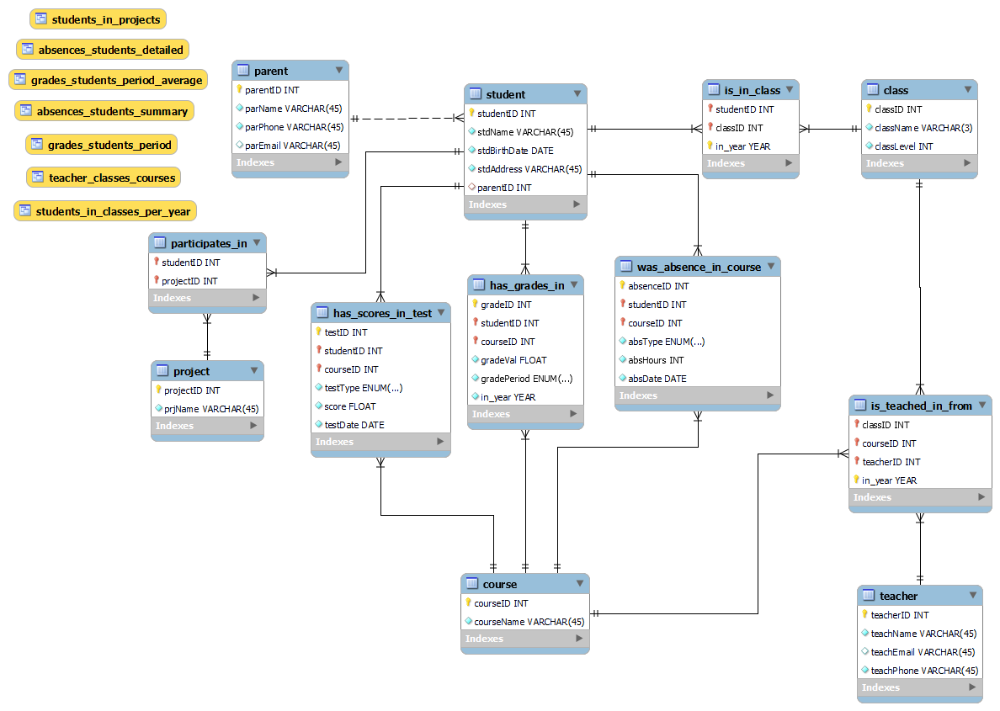

# School Management Database – MySQL

## Project Overview

A relational database system designed and implemented for the management of educational institution records as part of a collaborative academic project.

The database provides a structured approach to managing student information, academic performance, attendance records, teaching assignments, guardian information and school activities.

The project covers the database development lifecycle, from requirements analysis and conceptual data modeling to relational schema design and practical implementation using MySQL.

## Project Development

The project was completed in two main phases.

### Phase 1 – Database Design

- Requirements analysis
- Identification of entities and relationships
- Conceptual database modeling
- Entity-Relationship Diagram using Chen notation
- Relational schema design
- Primary and foreign key definition
- Referential integrity constraints
- Database view design
- Relational algebra expressions
- Data volume estimation
- User categories and access requirements

### Phase 2 – Database Implementation

- MySQL database implementation
- Database modeling using MySQL Workbench
- Table creation and relationship implementation
- Primary, foreign and composite keys
- Database population with synthetic sample data
- SQL query development
- Database view implementation
- User account and privilege management
- Database export and restoration

## Key Features

- Student and guardian information management
- Teacher and course management
- Student enrollment and class assignments
- Academic grade management
- Examination results tracking
- Attendance and absence tracking
- School project participation
- Academic year history
- Database views for academic reporting
- User-specific database access permissions

## Database Specifications

| Specification | Value |
|---|---|
| Database Management System | MySQL |
| Original MySQL Version | 8.0.25 |
| Storage Engine | InnoDB |
| Relational Tables | 12 |
| Database Views | 7 |
| Example SQL Queries | 8 |
| User Categories | 3 |
| Sample Student Records | 153 |

The original database design considered an educational institution of approximately 1,000 students and 30 teachers, with a historical data retention period of 50 years.

These figures represent design requirements rather than tested system capacity.

## Database Architecture

The database was modeled using MySQL Workbench and implements relationships between students, guardians, teachers, courses, classes, academic records and school activities.

### Enhanced Entity-Relationship Diagram

## Database Views

| View | Description |
|---|---|
| `students_in_projects` | Student participation in school activities |
| `absences_students_detailed` | Detailed student absence records |
| `grades_students_period_average` | Average academic grades by grading period |
| `absences_students_summary` | Aggregated student absence records |
| `grades_students_period` | Student grades by academic period |
| `teacher_classes_courses` | Teacher, class and course assignments |
| `students_in_classes_per_year` | Student enrollment by academic year |

## SQL Queries

The project includes eight SQL scripts demonstrating data retrieval and academic reporting.

| Query | Description |
|---|---|
| `query1.sql` | Student grades by academic period |
| `query2.sql` | Examination results for History courses |
| `query3.sql` | Written examination and test results |
| `query4.sql` | Student participation in school projects |
| `query5.sql` | Identification of failing academic grades |
| `query6.sql` | Identification of failing examination results |
| `query7.sql` | Students without an assigned guardian |
| `query8.sql` | Students without a class assignment for a specified year |

## Database Security and Access Control

The database implements differentiated access permissions using MySQL user accounts and SQL GRANT statements.

| User Category | Access Permissions |
|---|---|
| Administrator | Full privileges on the school database |
| Principal | SELECT, INSERT, UPDATE and DELETE |
| Teacher | SELECT and INSERT on designated academic tables |

## Technologies

- MySQL
- SQL
- MySQL Workbench
- InnoDB
- Relational Database Management Systems (RDBMS)
- Entity-Relationship Modeling
- Enhanced Entity-Relationship Modeling
- Relational Algebra
- Database Views
- Database Access Control

## Data Privacy

All sample student, guardian and teacher records, including names, addresses, contact details and academic information, are synthetic and were created exclusively for educational and demonstration purposes.

## Project Background

- Institution: Aristotle University of Thessaloniki (AUTH)
- Department: Electrical and Computer Engineering
- Course: Databases
- Project Type: Collaborative Academic Project
- Academic Year: 2023–2024
- Completion: December 2023

## Implementation Note

This repository preserves the original academic database design and SQL implementation developed in 2023.
